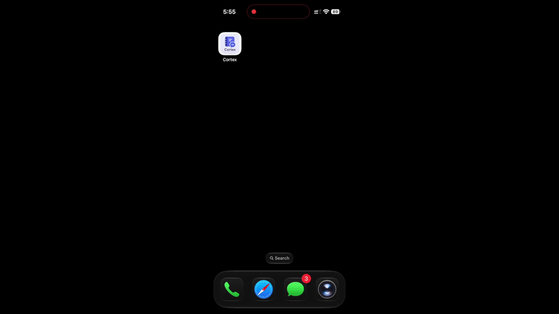
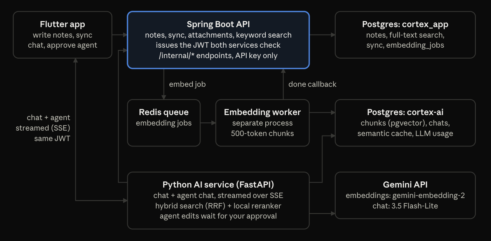

# Cortex

Cortex is an offline-first notes app: notes live in an encrypted database on your phone and sync across devices, with field-level conflict handling.
You can ask questions about your notes in plain language and get answers that cite the notes they came from, using hybrid keyword and semantic search with reranking.
A built-in agent can also search, create, update and delete notes for you, and any destructive action waits for your approval.

<p align="center">
  
</p>

## Architecture



Cortex is three repositories:

| Repository | What it does | Stack |
|---|---|---|
| **cortex** (this repo) | Mobile app: block editor, encrypted local database, sync engine, chat and agent UI | Flutter, Riverpod, Drift + SQLCipher |
| [**cortex_app_be**](https://github.com/abhishekpanja554/cortex_app_be) | Auth (JWT), notes, sync, attachments, keyword search; publishes embedding jobs | Spring Boot 4, Java 26, Postgres, Redis |
| [**cortex-ai**](https://github.com/abhishekpanja554/cortex-ai) | Embedding worker, hybrid search, reranking, RAG chat and agent, streamed over SSE | FastAPI, Python 3.14, pgvector, Gemini |

## Running it locally

Start the services in this order: cortex_app_be, then cortex-ai, then the app.

### Prerequisites

- PostgreSQL with the [pgvector](https://github.com/pgvector/pgvector) extension, version 0.7 or later (the vector index uses `halfvec`)
- Docker (for Redis)
- JDK 26
- Python 3.14 and [uv](https://docs.astral.sh/uv/)
- Flutter (stable channel, Dart 3.9+) with Xcode or Android Studio
- A [Gemini API key](https://aistudio.google.com/apikey)

Create the two databases:

```bash
createdb cortex_app
createdb cortex-ai
```

Generate two secrets. Both services need the same values.

```bash
export JWT_SECRET=$(openssl rand -base64 48)        # must be at least 256 bits
export CORTEX_AI_API_KEY=$(openssl rand -hex 32)    # service-to-service key for /internal/*
```

### 1. cortex_app_be (Spring Boot API, port 8080)

```bash
git clone https://github.com/abhishekpanja554/cortex_app_be.git
cd cortex_app_be

export DB_PASSWORD=<your postgres password>
# The datasource defaults to localhost:5432/cortex_app as user "abhis"; override it if yours differs:
export SPRING_DATASOURCE_USERNAME=<your postgres user>

./mvnw spring-boot:run
```

- Flyway creates the schema on first start.
- With Docker running, Spring Boot starts Redis from `compose.yaml` for you. Otherwise run `docker compose up -d` first.
- The app refuses to start if `JWT_SECRET` is missing or shorter than 256 bits.
- Uploaded images are stored in `./data/attachments`. Set `ATTACHMENTS_DIR` to change that.

### 2. cortex-ai (FastAPI service, port 8000, plus a worker)

```bash
git clone https://github.com/abhishekpanja554/cortex-ai.git
cd cortex-ai
uv sync
cp .env.example .env
```

Fill in `.env`:

| Variable | Value |
|---|---|
| `DB_USER`, `DB_PASSWORD` | Your Postgres login |
| `GEMINI_API_KEY` | Your Gemini key |
| `CORTEX_AI_API_KEY` | Same value as cortex_app_be |
| `JWT_SECRET` | Same value as cortex_app_be |
| `GEMINI_COMPLEX_MODEL` | Model for questions with 3+ sources, e.g. `gemini-3.5-flash-lite` |

Then run the migrations and start both processes, each in its own terminal:

```bash
uv run alembic upgrade head                                  # also enables the vector extension
uv run uvicorn app.api.main:app --reload --host 0.0.0.0      # HTTP API
uv run python -m app.worker.main                             # embedding worker
```

The first chat request downloads the reranker model (`cross-encoder/ms-marco-MiniLM-L-6-v2`, about 90 MB).

### 3. cortex (Flutter app)

```bash
git clone https://github.com/abhishekpanja554/cortex.git
cd cortex
flutter pub get
dart run build_runner build --delete-conflicting-outputs
```

**On a simulator or emulator** the defaults point at `localhost`:

```bash
flutter run
```

**On a physical phone over Wi-Fi**, point it at your computer's LAN address:

```bash
flutter run \
  --dart-define=API_BASE_URL=http://<your-lan-ip>:8080 \
  --dart-define=AI_BASE_URL=http://<your-lan-ip>:8000
```

**On an Android phone over USB**, you can skip the IP instead:

```bash
adb reverse tcp:8080 tcp:8080
adb reverse tcp:8000 tcp:8000
flutter run
```

Register an account in the app. Notes you write are embedded in the background within a few seconds, and then you can ask about them in **Ask Cortex**.

### Tests

```bash
flutter test
```

<!--
## Evaluation

TODO: add once the golden-question set exists.
- Number of questions and how they were written
- Hit rate / MRR before and after the reranker
- Whether it runs in CI
-->
